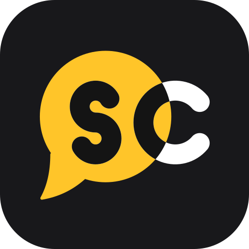
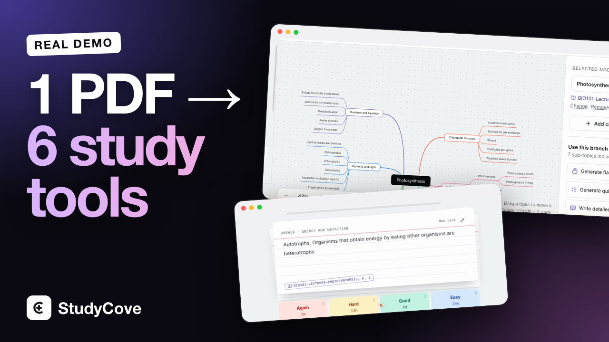
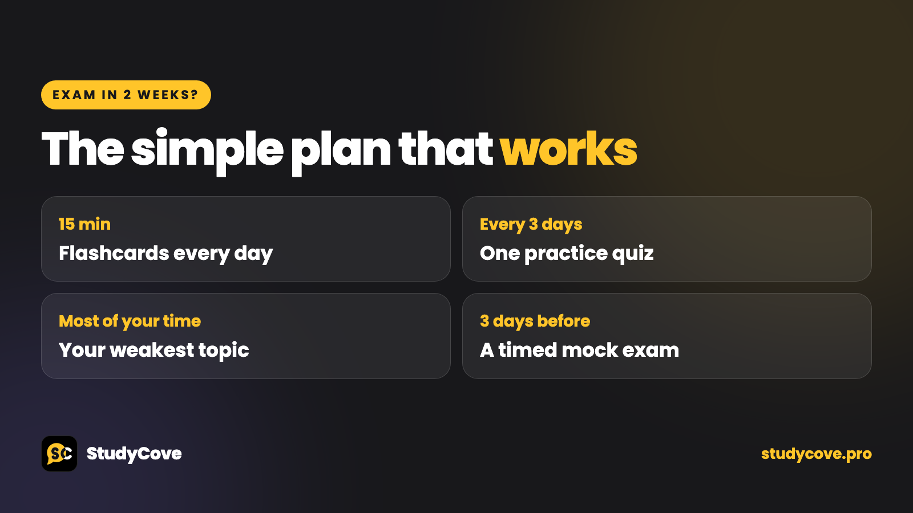

  

<h1 align="center">StudyCove</h1>

  <strong>Turn your lecture PDFs into flashcards, quizzes and mock exams.</strong> 
  <a href="https://studycove.pro">studycove.pro</a>

  

---

## Why I built it

Hey, I'm Kashif 👋

Every exam season looked the same: 40 slides per lecture, a week left, and the only "plan" was rereading everything and hoping it stuck. Rereading feels productive but it barely works. Testing yourself does, but making flashcards and practice questions by hand takes longer than the studying itself.

So StudyCove does that part for you.

## What you get from one upload

Drop in lecture slides, notes or a textbook chapter (PDF) and StudyCove builds a full study kit:

| | |
|---|---|
| 🗂️ **Flashcards with spaced repetition** | Each card comes back right before you'd forget it (FSRS scheduling). |
| ✅ **Practice quizzes** | Scores per topic, so you see exactly what's weak. |
| ⏱️ **Timed mock exams** | Sections, marks and a clock, so exam day doesn't feel new. |
| 💬 **AI tutor** | Answers questions from your own course material. |
| 📅 **Exam coach** | Turns "exam in 9 days" into a daily plan and keeps it updated. |
| 🧠 **Mind maps & notes** | The big picture of a topic, editable. |

  

## How students use it

1. Upload the week's lecture PDF.
2. Skim the mind map to see how the topic fits together.
3. Take one practice quiz cold.
4. Review the flashcards on today's plan (10–20 minutes).
5. Three days before the exam, sit a timed mock.

## Built with

Next.js · React · Supabase (Postgres + auth) · FSRS (`ts-fsrs`) · Mind Elixir · Google Cloud Run · Cloudflare

Read the build log: [What I learned building an AI study app with Next.js 16, Supabase and FSRS](https://dev.to/m_kashifiqbal_9589140133/what-i-learned-building-an-ai-study-app-with-nextjs-16-supabase-and-fsrs-2mfm)

## Try it & feedback

👉 **[studycove.pro](https://studycove.pro)** — sign in with Google.

This repo is the public home for StudyCove (the app itself is closed source). Found a bug or want a feature? [Open an issue](../../issues), I read every one.
